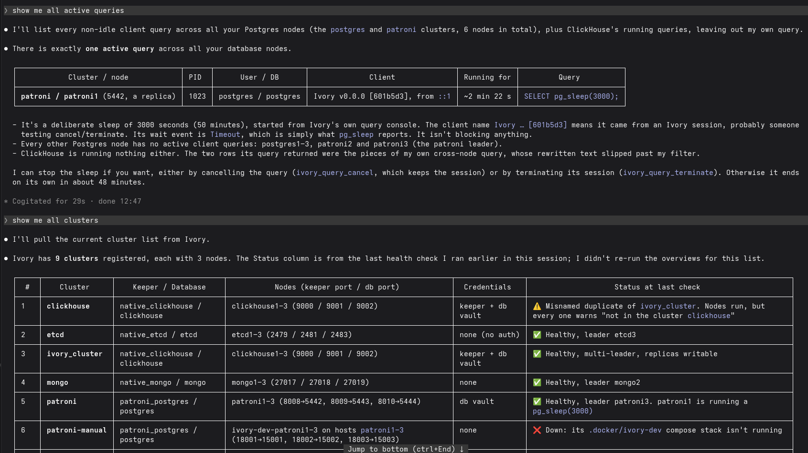

# [☰](../README.md) MCP Server

Ivory exposes its features to [Model Context Protocol](https://modelcontextprotocol.io) clients, so an
AI agent can read a cluster's health and operate it with the same permissions the signed-in user has.
The endpoint speaks streamable HTTP and lives at `/api/mcp` on the same address and port as the web UI.

It is the troubleshooting surface that benefits most: everything Ivory already knows about a cluster —
node roles, replication lag, pending restarts, its own drift warnings, VM metrics, container logs and
the saved diagnostic queries — becomes readable in one conversation instead of one screen at a time.



*Asked in plain words, the agent finds a long-running `pg_sleep` on one Patroni replica across six Postgres
nodes, offers `ivory_query_cancel`/`ivory_query_terminate` to stop it, and then summarises every registered
cluster — keeper, ports, credentials and health — including one that is down and one misnamed duplicate.*

---

## Connecting a client

Authentication is a bearer token: Ivory's ordinary session JWT, sent in the `Authorization` header.

**The quickest way is the web UI.** Open **Settings → Integrations → MCP Server**: it shows the endpoint
for this install, generates a token on request for the lifetime you pick — 1 hour, 6 hours, 1 day,
15 days or 30 days — and gives you a ready-to-copy config with both already
filled in — pick your client from the list. It covers Claude Code (the `claude mcp add` command and
`.mcp.json`), Cursor, VS Code, Codex, Antigravity, IntelliJ IDEA and Claude Desktop, plus a plain
transport/url/header summary for anything else that speaks streamable HTTP.

Before you generate a token the config shows `{{ivory_token}}`, highlighted exactly the way an unanswered
variable is in a deployment preview — one glance says which part is not real yet. Generate a token and it
is written in. Where a client reads the token out of an environment variable rather than inline — Codex,
and the `mcp-remote` bridge the two desktop clients use — the screen offers the matching
`export IVORY_TOKEN=…` to copy beside the config.

The shapes are not interchangeable, which is why each client gets its own rather than one block with the
hostname swapped:

| client | file | shape |
|---|---|---|
| Claude Code | `.mcp.json` | `mcpServers`, `type` + `url` + `headers` |
| Cursor | `.cursor/mcp.json` | `mcpServers`, `url` + `headers` |
| VS Code | `.vscode/mcp.json` | **`servers`**, not `mcpServers` |
| Codex | `~/.codex/config.toml` | **TOML**, and `bearer_token_env_var` names an env var instead of carrying the token |
| Antigravity | `.agents/mcp_config.json` | **`serverUrl`** — its docs say `url` is not supported |
| IntelliJ IDEA | Settings → Tools → AI Assistant → MCP | takes a remote `url` but documents no `headers` on it, so with auth on it goes through `mcp-remote` |
| Claude Desktop | `claude_desktop_config.json` | speaks no HTTP at all; goes through the `mcp-remote` bridge |

To do it by hand instead:

1. Mint a token. Signed in to the UI, ask for one for the session you already hold, saying how long it
   should live in seconds — anything up to 30 days (`2592000`), never unlimited:

   ```bash
   curl -sX POST http://localhost/api/auth/token \
     -H "Authorization: Bearer $OLD_TOKEN" \
     -H 'Content-Type: application/json' \
     -d '{"expiresIn": 86400}' | jq -r .response.token
   ```

   Or take one out of a fresh login, which always lasts one hour:

   ```bash
   TOKEN=$(curl -sX POST http://localhost/api/basic/login \
     -H 'Content-Type: application/json' \
     -d '{"username":"alice","password":"..."}' | jq -r .response.token)
   ```

   `POST /api/auth/token` needs no permission — it is the account you are already signed in as — and it
   re-checks that the account is still registered, so a user deleted since they signed in cannot keep
   minting. It writes no cookie, so generating a token for an agent leaves your browser session alone.

   **A minted token says it came from a session.** Its `frm` claim reads `session` rather than the
   `basic`/`ldap`/`oidc` a login would put there, so it is told apart from the token that asked for it.
   It is never offered as a way of signing in — a login screen lists the configured providers, and this
   is not one of them — and because no user is registered for it, **a session token cannot mint another
   one**. Only a login can, which is what keeps the lifetime you chose from being extended forever.

2. Point a client at the endpoint with that token. For Claude Code:

   ```bash
   claude mcp add --transport http ivory http://localhost/api/mcp \
     --header "Authorization: Bearer $TOKEN"
   ```

   Or, in `.mcp.json`:

   ```json
   {
     "mcpServers": {
       "ivory": {
         "type": "http",
         "url": "http://localhost/api/mcp",
         "headers": { "Authorization": "Bearer ${IVORY_TOKEN}" }
       }
     }
   }
   ```

> **The token lives exactly as long as you chose, and cannot be revoked.** Ivory stores no tokens, so
> once one is issued it stays valid until it expires — deleting the user, changing their password or
> signing out does not end it early. Pick the shortest lifetime the agent needs, and treat a 30-day token
> like a password that cannot be changed for a month.
>
> Nothing refreshes it either: a token sent in the `Authorization` header is never renewed, so when it
> expires the agent starts failing with `401`. Replacing it is a click in
> **Settings → Integrations → MCP Server** — generate another and update the client — but an agent cannot
> do it for itself: the token it holds came from a session and will not mint a successor.

When Ivory runs with authentication switched off, no token is needed and every tool is available —
the same as the REST API, which is already unauthenticated in that mode.

---

## Permissions

An MCP client sees **only the tools the user holds permission for**. Each tool reuses the permission of
the REST route it mirrors, so nothing new has to be granted: a user who may view a cluster overview in
the UI gets `ivory_cluster_overview`, and a user who may not run a switchover never sees
`ivory_keeper_switchover` at all.

The tool list is recomputed on every request, so revoking a permission takes effect on the agent's next
call without reconnecting.

Tools are also annotated for the client's approval prompt: read-only tools are marked as such, and the
ones that can break something are marked destructive.

---

## Tools

**Each tool takes the same arguments as the REST route it mirrors.** A tool lives in the feature it
belongs to (`cluster_router_mcp.go`, `node_router_mcp.go`, …) and speaks that feature's own request
shape, so there is one contract behind two transports. Only `cluster` tools are addressed by cluster name; `node` and
`query` tools are addressed the way the web UI addresses them — by host, port and vault id.

So the usual flow is two steps, exactly as the UI does it:

```
1. ivory_cluster_get { "name": "prod" }
   -> nodes[{name, host, sshPort, keeperPort, dbPort}],
      plugins{keeper, database}, tls, certs,
      vaults{keeperId, databaseId, sshKeyId}

2. ivory_keeper_node_list {
     "host": "10.0.0.1", "port": 8008,
     "cluster": "prod", "plugin": "patroni",
     "vaultId": "<vaults.keeperId from step 1>"
   }
```

A tool requires an argument only where the REST request does (`binding:"required"`); everything else
defaults the way an omitted JSON field does, and the feature's own validation names whatever it still
needs. `ivory_cluster_overview` is the exception worth knowing: it resolves every node of a cluster
itself, which is why it is one call and the fastest route to a diagnosis.

### Clusters

| Tool | Permission |
|------|------------|
| `ivory_cluster_list` — registered clusters, with nodes, plugins and tags | `view.cluster.list` |
| `ivory_cluster_get` — one cluster's stored configuration | `view.cluster.item` |
| `ivory_cluster_overview` — live health: roles, state, lag, warnings | `view.cluster.overview` |
| `ivory_tag_list` — every tag and the clusters carrying it | `view.tag.list` |
| `ivory_cluster_create` / `ivory_cluster_update` | `manage.cluster.create` / `.update` |
| `ivory_cluster_delete` — removes the registration only | `manage.cluster.delete` |
| `ivory_cluster_detect` — register from one running keeper endpoint | `manage.cluster.create` |
| `ivory_cluster_fix` — replace the node list with what the keeper reports | `manage.cluster.update` |
| `ivory_cluster_deploy` — deploy a whole new cluster | `manage.cluster.create` |

### Keeper

| Tool | Permission |
|------|------------|
| `ivory_keeper_node_list` — one node's view of the members | `view.node.keeper.overview` |
| `ivory_keeper_config_get` | `view.node.keeper.config` |
| `ivory_keeper_config_update` | `manage.node.keeper.config.update` |
| `ivory_keeper_switchover` / `ivory_keeper_switchover_cancel` | `manage.node.keeper.switchover` |
| `ivory_keeper_failover` | `manage.node.keeper.failover` |
| `ivory_keeper_reinitialize` | `manage.node.keeper.reinitialize` |
| `ivory_keeper_restart` / `ivory_keeper_restart_cancel` | `manage.node.keeper.restart` |
| `ivory_keeper_reload` | `manage.node.keeper.reload` |
| `ivory_keeper_activate` / `ivory_keeper_pause` | `manage.node.keeper.activation` |

Keeper tools take `KeeperOneRequest` — the connection (`host`, `port`), the cluster name, the plugin, the
vault id, and a free-form `body` passed straight to the keeper, the same body the REST route forwards:

| operation | body |
|---|---|
| switchover | `{"leader": "<key>", "candidate": "<key>", "scheduled_at": "<iso-8601>"}` |
| failover | `{"candidate": "<key>"}` |
| restart | `{"schedule": "<iso-8601>", "restart_pending": true}` |
| reinitialize | `{"force": true}` |
| config update | the patch, in the shape that keeper's own API expects |

`leader` and `candidate` are the **keeper's own member keys**, which `ivory_cluster_overview` reports as
each node's `keeper.key`. Patroni does not accept a host there. Send a switchover to the current leader.

### Node system and containers

| Tool | Permission |
|------|------------|
| `ivory_system_metrics` / `ivory_system_processes` / `ivory_system_info` / `ivory_system_logs` | `view.node.system` |
| `ivory_system_copy_id` — install a public key in `authorized_keys` | `manage.node.system` |
| `ivory_container_list` / `ivory_container_logs` / `ivory_container_metrics` | `view.node.platform.container` |
| `ivory_container_start` / `_stop` / `_restart` / `_up` / `_down` / `_exec` | `manage.node.platform.container` |
| `ivory_container_keeper_deploy` — deploy one node of a cluster | `manage.node.platform.container` |

System and container tools take a `PlatformVaultConnection` (`host`, `port`, `vaultId`, `platform`) — the
ssh port and the cluster's `vaults.sshKeyId` from `ivory_cluster_get`. Metrics are counters, not
percentages: call twice and take the difference. Log tools return a bounded tail (100 lines unless `tail`
says otherwise) rather than a live stream, and report a failure to read the log in `notes` beside the
lines, because the underlying stream pushes its problems as messages rather than returning an error.

### Database

| Tool | Permission |
|------|------------|
| `ivory_query_list` — the shipped and user-saved queries | `view.query.crud.list` |
| `ivory_query_log_get` | `view.query.log.list` |
| `ivory_query_activity` / `ivory_query_databases` / `ivory_query_schemas` / `ivory_query_tables` | `view.query.db.info` |
| `ivory_query_chart` | `view.query.db.chart` |
| `ivory_query_template` — run a saved query | `manage.query.db.template` |
| `ivory_query_console` — run arbitrary SQL | `manage.query.db.console` |
| `ivory_query_cancel` / `ivory_query_terminate` | `manage.query.db.cancel` / `.terminate` |
| `ivory_query_create` / `_update` / `_delete` | `manage.query.crud.*` |
| `ivory_query_log_delete` | `manage.query.log.delete` |

### Deployment templates

| Tool | Permission |
|------|------------|
| `ivory_deployment_template_list` — shipped and user templates | `view.deployment.template.list` |
| `ivory_deployment_template_create` / `_update` / `_delete` | `manage.deployment.template.*` |

### Ivory itself

`ivory_app_info` reports the version, configuration state and which authentication methods are accepted.
It mirrors the unauthenticated `/info` route and needs no permission.

---

## What this lets an agent do

Granting `manage.*` permissions to a token an agent holds means the agent can take a production cluster
down. That is the same power the user already has in the UI, and Ivory gates it the same way — but a UI
click and a tool call are not equally deliberate, so it is worth being explicit:

- `ivory_keeper_failover` forces a leader change without the checks a switchover makes, and **can lose
  committed data** if the candidate is behind.
- `ivory_keeper_reinitialize` wipes a member's data directory and re-clones it from the leader.
- `ivory_keeper_pause` switches off automatic failover and nothing reminds you later.
- `ivory_container_down` stops **and removes** a container, including the logs that would have explained
  a failure.
- `ivory_container_exec` and `ivory_container_up` run commands you supply on the host or inside a
  container. There is no allow-list — that is what a deployment is.
- `ivory_query_console` runs SQL verbatim. Ivory does not classify statements anywhere, so `DROP` is as
  reachable as `SELECT`.

If an agent should only diagnose, give its user `view.*` permissions and nothing else: the mutating tools
then do not appear in its tool list at all. Most MCP clients also prompt before each call and honour the
destructive annotation Ivory sets.

### Not exposed

Some of Ivory's REST surface has deliberately no tool:

- **Erase, free and secret rotation** — irreversible, whole-install operations with no diagnostic value.
- **Backup export and import** — binary file transport, and the export carries secrets.
- **Vault, certificate, user and permission administration** — these move credentials through tool
  arguments, and letting an agent edit permissions would let it widen its own access.

A deploy names its credentials as **vault ids**, never as inline passwords, for the same reason: no
secret passes through the agent's context. `ivory_cluster_deploy` therefore omits the inline
`sshUser`/`sshPass`/`dbUser`/`dbPass` fields the REST route accepts — create the vault entries in the UI
first and name them in `options.vaults`.

---

## How it is built

MCP is a second engine beside the http one, not a feature of its own:

- `core/engine/engine_mcp.go` is the MCP engine, the sibling of `engine_http.go`. It declares every tool
  next to the permission that gates it and the feature router that serves it — the same thing the route
  table does — and it builds the transport. `main.go` creates it and hands it to the http engine, which
  mounts it at `/api/mcp`.
- Each feature keeps its own MCP implementation in its own package, in `<feature>_router_mcp.go`, beside
  the http router it already has: `cluster_router_mcp.go`, `node_router_mcp.go` (plus
  `node_router_mcp_keeper.go` / `node_router_mcp_platform.go`), `query_router_mcp.go`,
  `deployment_router_mcp.go`, `tag_router_mcp.go`, `management_router_mcp.go`. Both transports share the
  request and response types, named `Router***Request`/`Router***Response`.
- Only `cluster` resolves a cluster into connections, because only `cluster` imports `node` and `query`.
  That is why node and query tools are addressed directly.

## Notes

- The endpoint is stateless: every request carries its own session, and `Mcp-Session-Id` is not used.
- Requests are capped at 4 MB.
- Cross-origin browser requests are rejected. Non-browser MCP clients send no `Origin` and are unaffected.
- Behind a reverse-proxy sub-path, the endpoint moves with it: `IVORY_URL_PATH=/ivory` puts it at
  `/ivory/api/mcp`.
