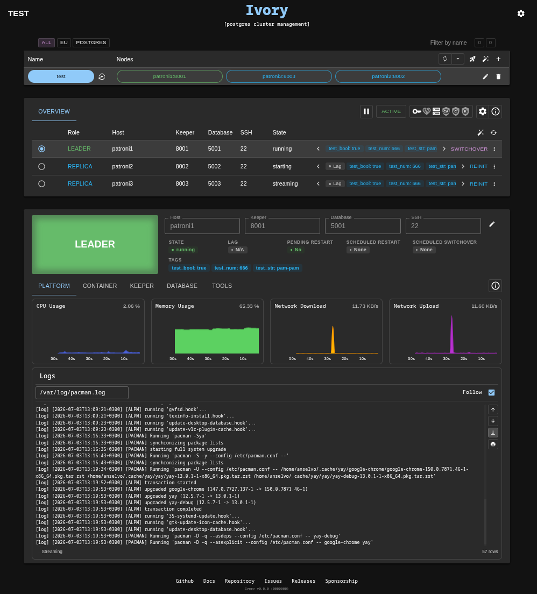

   

# Ivory

### DEPLOY. WATCH. FIX. ANYWHERE

**Ivory is home for your database clusters — deploy, watch and fix them from anywhere.**

   
   
   

 

**One place for the whole life of a cluster.** One web UI to **deploy a cluster**, watch its **health and replication lag**, run a **switchover or failover**,
open a **SQL query console**, control **containers over SSH**, and read **VM metrics and logs** — from your
browser or your phone. One Docker container, **no agent on your hosts, no orchestrator, no cloud account.**
New to Ivory? Start with [About Ivory](.doc/about.md).

**🤖 AI-ready out of the box.** Plug Claude, Cursor, Codex or any AI agent into Ivory's built-in
[MCP server](.doc/mcp.md) and just ask: *"why is replica 2 lagging?"*, *"what's blocking my queries?"*,
*"switch the leader to node 3"*.

---

### ⭐ [Star Ivory on GitHub](https://github.com/veegres/ivory) — it takes one click ⭐

---

   
Stars keep the author motivated to keep building Ivory. Want to help more? [Support it on Boosty](https://boosty.to/anselvo) ❤️

## Features

**Deployment — spin up a high-availability cluster over plain SSH**

- [Deploying a cluster](.doc/deployment.md#deploying-a-cluster) — over SSH, with no orchestrator or agent
- [Deploying a single cluster node](.doc/deployment.md#deploying-a-single-cluster-node) — add or rebuild one node of an existing cluster
- [Deployment templates](.doc/deployment.md) — the command that runs on each node, saved and reusable
- [Default templates](.doc/deployment.md#default-templates) — ready to deploy for every supported database, in two variants:
    - **Multi host** — one node per machine, the usual layout for a real cluster
    - **Single host** — the whole cluster on one machine, for trying it out locally or on a test VM

**Cluster management — HA operations from the browser**

- [Cluster list](.doc/clusters.md) — register manually, auto-detect from one address, or deploy
- [Cluster health](.doc/overview.md) — node roles, replication lag, pending restarts, warnings
- [HA operations](.doc/overview.md#ha-operations) — switchover, failover, reinitialise, restart, reload, pause
- [Database configuration](.doc/node.md#configuration) — view and patch settings per node

**Node operations — the machine and the container behind each node**

- [Container lifecycle](.doc/node.md#container) — deploy, start, stop, restart, remove, logs
- [Keeper operations per node](.doc/node.md#keeper) — the same HA actions in a full-page view
- [VM metrics](.doc/node.md#system) — CPU, memory, network and processes on the host
- [Log streaming](.doc/node.md#logs) — any file on the host, or container output

**Database troubleshooting — query console and maintenance tools**

- [Query builder](.doc/node.md#database) — saved SQL queries for monitoring and diagnostics
- [Database tools](.doc/node.md#tools) — engine-specific maintenance tools, run as background jobs with live output:
    - **Postgres** — [pgcompacttable](.doc/tools/postgres/pg_compacttable.md), reduces table and index bloat without heavy locks

**Access control and operations**

- [Authentication](.doc/authentication.md) — Basic, LDAP and OIDC/SSO, with granular per-user permissions
- [Configuration](.doc/configuration.md) — data persistence, upgrades, TLS, reverse-proxy sub-path
- [MCP server](.doc/mcp.md) — expose Ivory to an AI agent, gated by the same per-user permissions

## Get started

Ivory ships as one Docker image with no external dependencies.

1. Start the docker container
    - 🐳 **Docker Hub** `docker run -p 80:80 --restart always veegres/ivory`
    - 📦 **GitHub Container registry** `docker run -p 80:80 --restart always ghcr.io/veegres/ivory`
2. Go to http://localhost:80
3. Complete the initial setup wizard (authentication, secret key)
4. Add your first cluster — **manual** (all node addresses), **auto-detect** (one address, Ivory
   finds the rest), or **[deploy](.doc/deployment.md)** a new one from a template
5. Start monitoring

## Documentation

| Page                                     | What's in it                                                        |
|------------------------------------------|---------------------------------------------------------------------|
| [About](.doc/about.md)                   | What Ivory is, vision, why these databases                          |
| [Getting started](.doc/getting-started.md) | Run the container, the setup wizard, adding your first cluster    |
| [Core concepts](.doc/concepts.md)        | Cluster, node, keeper, plugins, platform, templates, vault          |
| [Clusters](.doc/clusters.md)             | Adding clusters manually, auto-detection, tags and filtering        |
| [Cluster overview](.doc/overview.md)     | Cluster health, warnings, HA operations, cluster options            |
| [Node](.doc/node.md)                     | System, Container, Keeper, Database and Tools tabs                  |
| [Deployment](.doc/deployment.md)         | Deploy a cluster or one node, deployment templates, variables       |
| [Supported databases](.doc/databases.md) | Every engine compared, and one page per database on how Ivory runs it |
| [Authentication](.doc/authentication.md) | Basic / LDAP / OIDC, users, superusers, permissions                 |
| [Configuration](.doc/configuration.md)   | Data persistence, upgrades, environment variables, TLS, sub-path    |
| [MCP server](.doc/mcp.md)                | Connecting an AI agent, the tool list, permissions and blast radius |
| [FAQ](.doc/faq.md)                       | Upgrades, data location, agents, credentials, proxies, phones       |

## Supported databases and clusters

| Database                                   | Cluster                                                                   | Stage  |
|--------------------------------------------|---------------------------------------------------------------------------|--------|
| [PostgreSQL](.doc/databases/patroni.md)    | High-availability cluster with [Patroni](https://patroni.readthedocs.io/) | STABLE |
| [PostgreSQL](.doc/databases/postgres.md)   | Primary and standby replication                                           | STABLE |
| [etcd](.doc/databases/etcd.md)             | Raft cluster                                                              | BETA   |
| [Redis](.doc/databases/redis.md)           | Master and replica replication                                            | BETA   |
| [ClickHouse](.doc/databases/clickhouse.md) | Replicated cluster                                                        | BETA   |
| [ZooKeeper](.doc/databases/zookeeper.md)   | Ensemble                                                                  | BETA   |
| [MongoDB](.doc/databases/mongodb.md)       | Replica set                                                               | BETA   |

What Ivory does with each — operations, lag, warnings, console and deploy templates — is in
[Supported databases](.doc/databases.md). Why these ones, and where Ivory is heading, is in
[About Ivory](.doc/about.md#why-these-databases).

**Missing your database? You can add it.** Every engine is a self-contained plugin, so supporting a new one
needs no change to Ivory's core. The repository ships an AI agent for exactly this,
[`keeper-database-plugin`](.claude/agents/keeper-database-plugin.md): ask Claude Code to use it for your engine
and it writes the keeper and database plugins, their tests and the UI wiring by the project's checklist —
then open a PR (see [Contribution](#contribution)).

## Contribution

Contributions are welcome — see [CONTRIBUTING.md](CONTRIBUTING.md) for the local setup, conventions and how
to send a change, [open issues](https://github.com/veegres/ivory/issues) (or the
[good first issues](https://github.com/veegres/ivory/issues?q=is%3Aissue+is%3Aopen+label%3A%22good+first+issue%22))
for something to pick up, and [SECURITY.md](SECURITY.md) for supported versions and reporting a vulnerability.

## What Ivory is used for

Ivory is a self-hosted, open-source GUI, web dashboard and MCP server for database cluster management,
monitoring and troubleshooting. One tool, the same workflow for every engine:

- **PostgreSQL + Patroni GUI** — Patroni web UI for cluster health, replication lag, switchover, failover,
  reinitialise and restart, plus a PostgreSQL query console, bloat and activity diagnostics and pgcompacttable.
- **PostgreSQL management UI** — plain Postgres primary/standby monitoring, without needing Patroni.
- **etcd GUI** — etcd cluster web UI for members, leader, raft lag and alarms, plus a key-value console.
- **Redis GUI** — Redis replication monitoring and a command console for master/replica setups.
- **ClickHouse GUI** — ClickHouse cluster monitoring, replication delay and queue, and a SQL console.
- **MongoDB GUI** — MongoDB replica set monitoring — primary, secondaries and replication lag.
- **ZooKeeper GUI** — ZooKeeper ensemble web UI for leader, followers and a znode console.
- **Cluster deployment over SSH** — deploy a highly available Postgres, etcd, Redis, ClickHouse, MongoDB or
  ZooKeeper cluster to your own VMs with Docker, from ready-made templates — no Kubernetes, Ansible or agent.
- **AI DBA assistant** — an MCP server for PostgreSQL, Patroni, etcd, Redis, ClickHouse, MongoDB and ZooKeeper,
  so Claude, Cursor, Codex or any MCP client can diagnose and fix database clusters in plain language.
- **On-call from your phone** — a mobile-friendly database dashboard for checking and fixing a cluster away
  from your laptop.
